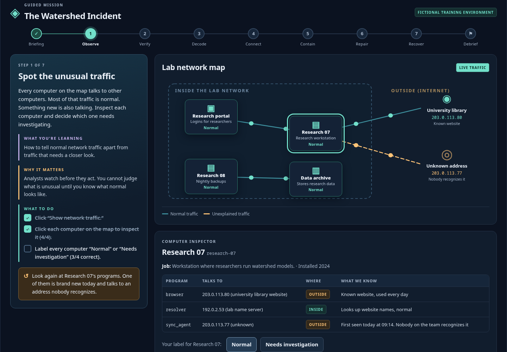
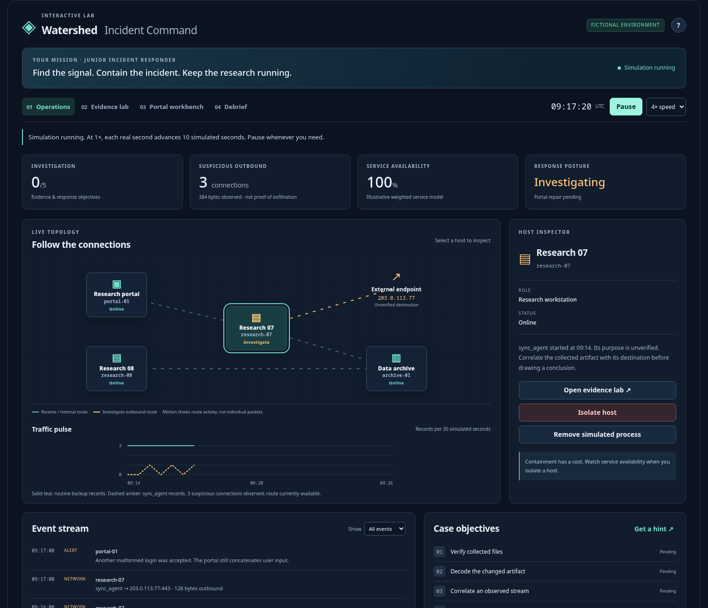

# Watershed Cyber Lab

A cybersecurity lab that runs in the browser. Students work a fictional incident step by step, with graphics and no code. It is built on Jupyter, but students never see a notebook.



## Quick start

You need **Python 3.10 or newer** on Linux or macOS (a Jetstream2 VM works). No GPU, API key or account is needed.

```bash
git clone https://github.com/Lagarhythm/watershed-cyber-lab.git
cd watershed-cyber-lab
./start.sh
```

Then open **http://127.0.0.1:8866** in your browser. That's it.

- The first run installs everything into a private `.venv` folder (about a minute). Later runs start right away. Press **Ctrl+C** in the terminal to stop.
- **Ubuntu says `venv` is missing?** Run `sudo apt-get install -y python3-venv` once, then `./start.sh` again. This is the only step that may need admin rights.
- **After `git pull`**, just run `./start.sh`; it reinstalls automatically when `requirements.txt` changes.

**Where to open the page:**
- **On your own computer, or in the Jetstream Web Desktop:** use the browser on that same machine.
- **Your own browser, lab running on a Jetstream VM over SSH:** on your own computer run `ssh -N -L 8866:127.0.0.1:8866 exouser@VM_PUBLIC_IP` (the user is `exouser` for Exosphere-created instances, `ubuntu` for others), leave it running, and open the same URL locally. No public port is opened.

**Windows, or if `start.sh` fails**, do the same thing by hand:

```bash
python -m venv .venv
.venv\Scripts\activate          # Linux/macOS: source .venv/bin/activate
python -m pip install -r requirements.txt
python launch.py
```

## What students see: the Guided Mission

The default. The Watershed incident, one step at a time, with no clock. Every step tells students **what they are learning**, **why it matters**, and **what to do** (a 3–5 part checklist: inspecting and labeling computers, comparing fingerprints, identifying Base64, filtering the real network log, testing containment, typing their own SQL injection, cleaning up in the right order). After each task they see **what they learned** and answer one quick check before moving on. Seven steps (Observe → Verify → Decode → Connect → Contain → Repair → Recover), then a debrief. About 30 minutes.

All lesson wording lives in `STEPS` in `mission/engine.py`, so instructors can edit the text without touching the interface.

## Free-play dashboard (`./start.sh --full`)

The same incident as an open simulation with a clock, for learners who have finished the mission or for live faculty demos. Students click hosts, watch traffic, investigate evidence, contain systems, test a portal repair, and review the consequences of their decisions. Click **Start simulation**; use the four views across the top. **Pause freely** while investigating. The question-mark button opens the mission brief. The **Debrief** view can export a report or reset the scenario.



The app includes a clickable animated network map, traffic chart, event filters, live service metrics, an integrity scanner, artifact decoding, a visual hash experiment, a no-code SQL-injection/repair workbench, reversible containment decisions and an after-action review. All graphics are driven by the simulated state. It works offline after dependency installation, with no external AI or GPU required.

Browser-local progress offers **Resume saved attempt** after reopening. It is one save per browser profile and origin; reset between learners on a shared profile. See [the simulation guide](instructor/SIMULATION_GUIDE.md) for a 15–25 minute teaching sequence, architecture, scoring and model limitations.

## Optional code-oriented companion

`Cybersecurity_Interactive_Lab.ipynb` is the original five-lesson/six-stage CTF notebook. Use it when students need to inspect pandas or edit Python; it is a deeper follow-up to the mission. After the quick start has run once:

```bash
source .venv/bin/activate
python -m ipykernel install --user --name watershed-lab --display-name 'Python (Watershed lab)'
jupyter lab Cybersecurity_Interactive_Lab.ipynb
```

Select **Python (Watershed lab)** and Run All Cells; its initial code-check failures are intentional.

## Jetstream2 sizing

An **m3.quad is comfortably sufficient for one person running this demo**: 4 vCPUs, 15 GB RAM, and a 20 GB root disk. No GPU is required. An m3.small (2 vCPUs, 6 GB RAM) should also be adequate for a single session, although this package has not been benchmarked on either flavor. See the [official flavor table](https://docs.jetstream-cloud.org/general/vmsizes/). Cohort-wide JupyterHub capacity is a separate sizing question. You can also download the repository ZIP from GitHub instead of cloning; keep the whole folder together, including `mission/`, `simulator/` and `jupyter/`.

## Companion notebook over SSH

Start Jupyter on the VM:

```bash
source .venv/bin/activate
jupyter lab --no-browser --ip=127.0.0.1 --port=8888
```

In a terminal on your own computer, forward that port (replace `VM_PUBLIC_IP`):

```bash
ssh -N -L 8888:127.0.0.1:8888 exouser@VM_PUBLIC_IP
```

Open Jupyter's printed `http://127.0.0.1:8888/lab?token=...` URL in your local browser. This uses the existing SSH connection; no public Jupyter port is needed. In either access method, open `Cybersecurity_Interactive_Lab.ipynb`, select **Python (Watershed lab)**, and run all cells.

## JupyterHub fit

It uses only Python, pandas, matplotlib and Jupyter, and needs no GPU, CUDA, model weights, API key, or cloud credentials. Start with a CPU user environment; the supplied evidence is under 25 KB. Actual per-user Hub memory and concurrency limits should be measured on the deployment.

Install the requirements in the **user kernel image/environment**, and provide JupyterLab widget support in the server environment if it is separate. Copy the student package into each user's writable home, select the matching kernel, and run all cells. One writable copy per learner prevents shared progress files. No changes to Hub authentication or Kubernetes are required by this notebook. Deployment on the project's Hub remains an operator step; this package does not create infrastructure.

For an offline classroom, install dependencies in the image before the session. Alternatively, on an Internet-connected machine with the same OS/architecture and Python version, run `python -m pip download -r requirements.txt -d wheels`, then install using `python -m pip install --no-index --find-links wheels -r requirements.txt`. No lesson cell downloads data or accesses a network.

If a widget appears as plain text, check the selected kernel and the server's widget extension. Restart the kernel and reload the page after installation. Official references: [ipywidgets installation](https://ipywidgets.readthedocs.io/en/stable/user_install.html), [nbclient execution](https://nbclient.readthedocs.io/en/latest/client.html).

## Companion notebook progress, reset, and distribution

Progress is an anonymous local JSON file at `.progress/session.json`. It survives a kernel restart. No PII or answers typed into fields are logged. Attempts, failed attempts, unique hint levels revealed, lesson checks, and stage completion are recorded. The optional dashboard's cohort is **simulated**, separate from this live session.

To start a new learner, enable the instructor view, check the reset confirmation and click **Reset progress**. Restart the kernel and run all cells. For a completely original code exercise, reopen a fresh copy of the supplied notebook: a reset does not overwrite learner code edits or case notes.

The instructor toggle is presentation convenience, not access control. Answers and validators in a local Python notebook can be inspected. The exact completion token is computed only when the last stage passes; it is not a literal in the student source. This is formative assessment, not a secure graded exam. For higher-stakes use, move validation and records to a separately authenticated service.

`python package_student.py` creates `../cybersecurity_showcase_student.zip` containing both notebooks, simulator, companion runtime, data, requirements, and a student quickstart, excluding instructor solutions, test answers, progress, and notebook outputs. Do not distribute a completed personal notebook as the starter.

## Instructor materials

- `docs/PRD.md`: product requirements as built, the build playbook, and a checklist for making a similar lab.
- `instructor/SIMULATION_GUIDE.md`: current student app, presentation sequence, scoring, persistence, model assumptions and customization.
- The five original guides below cover the optional code-oriented companion.

- `instructor/INSTRUCTOR_FACILITATION_GUIDE.md`: pacing, misconceptions, solution, debrief.
- `instructor/INSTRUCTOR_BUILD_GUIDE.md`: how the components work and why.
- `instructor/JUPYTER_CAPABILITY_REFERENCE.md`: teaching-value and activity mapping.
- `instructor/CUSTOMIZATION_GUIDE.md`: concrete adaptation examples.
- `instructor/DEMO_SCRIPT.md`: a 20-minute faculty presentation.
- `VALIDATION.md`: validation scope and deployment limits.

## Maintain and validate

```bash
python -m pip install -r requirements-dev.txt
python -m pytest -q
```

Tests execute a fresh copy of the notebook twice, exercise widget callbacks, solve the evidence chain, check code assessment and reset/persistence, and validate the student archive. `make_data.py` recreates deterministic synthetic evidence. `build_notebook.py` rebuilds the starter notebook and **overwrites notebook edits**; edit that generator when maintaining the published starter. `build_simulation.py` regenerates the student app notebook. These scripts are not needed by students.
